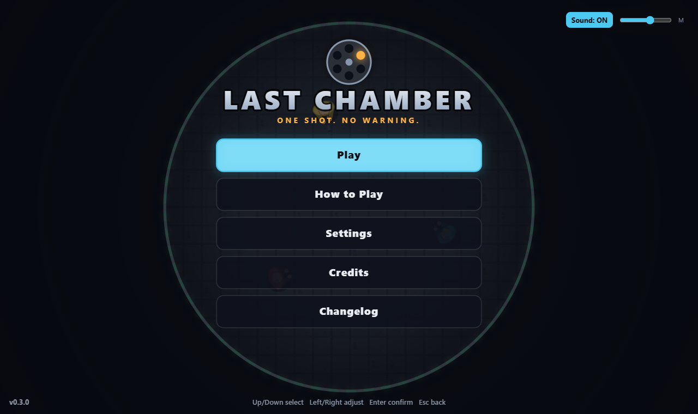
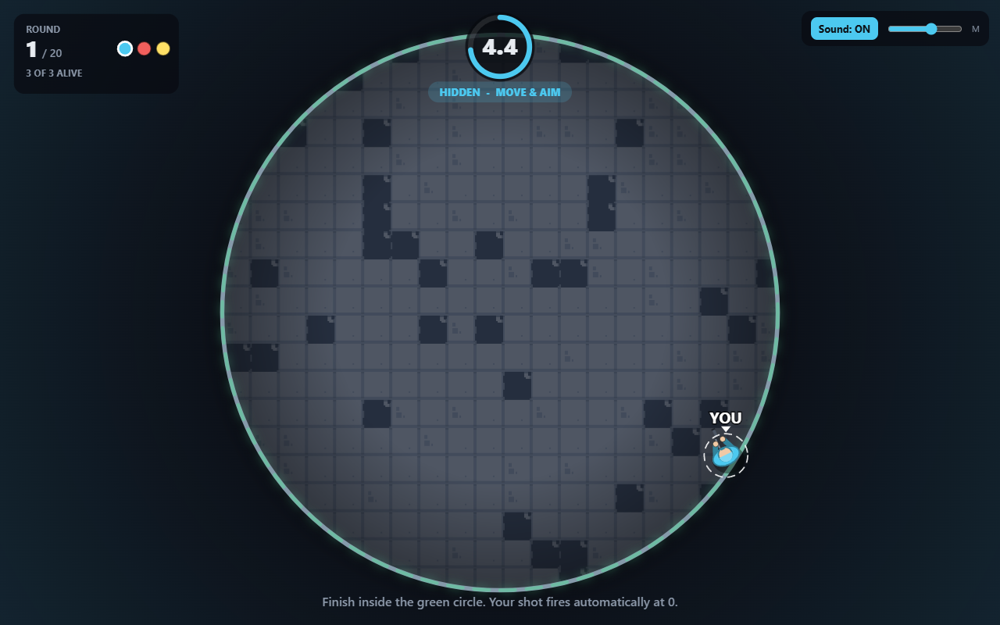
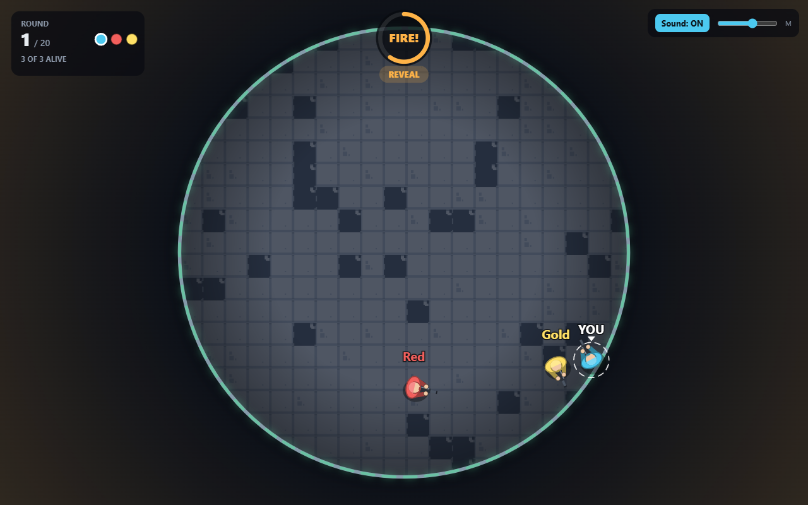
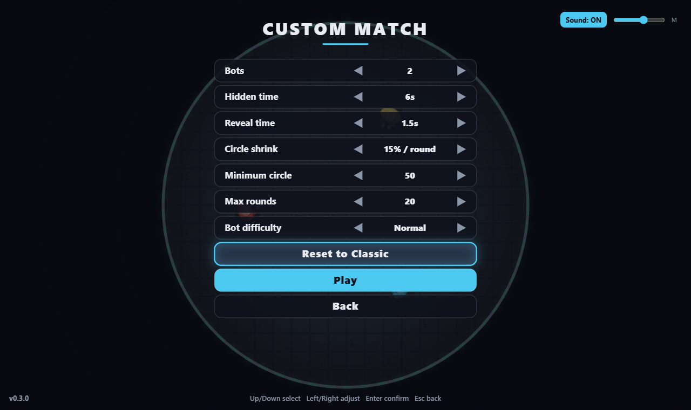
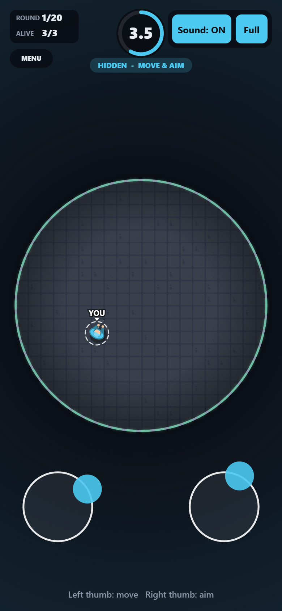
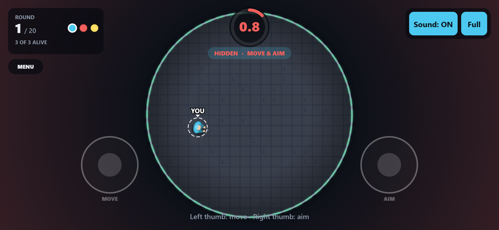

<div align="center">

# Last Chamber

**One shot. No warning.**

A fast, top-down elimination game for the browser. Move blind, aim blind, and trust your read of the arena. When the timer hits zero everyone is revealed and fires at once.




</div>

---

## Table of contents
- [How it plays](#how-it-plays)
- [Screenshots](#screenshots)
- [Game modes](#game-modes)
- [Controls](#controls)
- [Getting started](#getting-started)
- [Project structure](#project-structure)
- [Design notes](#design-notes)
- [Testing](#testing)
- [Roadmap](#roadmap)
- [Credits and license](#credits-and-license)

## How it plays
1. **Hidden phase.** Every round you have a few seconds to move and aim. Opponents are invisible, and so are you to them.
2. **Reveal.** At zero, all players are shown and each fires one instant shot at the nearest target in front of them. Shots resolve simultaneously, so mutual kills happen.
3. **The circle shrinks.** Stand outside the safe circle when the round resolves and you are eliminated too.
4. **Last survivor wins.** If nobody is left standing, the round is a draw.

There is no fire button. The skill is positioning, aiming and predicting where others will be.

## Screenshots

| Hidden phase | Reveal |
| :---: | :---: |
|  |  |

| Custom match | Mobile (portrait) | Mobile (landscape) |
| :---: | :---: | :---: |
|  |  |  |

## Game modes
Play > Single Player offers:

| Mode | What changes |
| --- | --- |
| **Classic** | The original rules: 1 vs 2 bots, 6 s hidden phase |
| **Quick Draw** | 3 s rounds and a faster shrink |
| **Crowded Arena** | 1 vs 4 bots, expect chain kills |
| **Tight Circle** | The safe circle shrinks hard every round |
| **Marathon** | 10 s rounds, gentle shrink, 30 rounds |
| **Custom** | 1-5 bots, hidden and reveal time, shrink speed, minimum circle, max rounds, bot difficulty (saved between sessions) |

Multiplayer is shown as "coming soon". The menu also includes How to Play, Settings (volume, sound, reduce flashing), Credits and an in-game Changelog.

## Controls

| Input | Action |
| --- | --- |
| **WASD / arrow keys** | Move |
| **Mouse** | Aim |
| **Touch: left stick** | Move |
| **Touch: right stick** | Aim (the gun keeps its direction when you let go) |
| **R** | Restart with the same mode |
| **Esc** (or **MENU** twice on touch) | Back to the menu |
| **M** / Sound button | Mute |

Menus: Up/Down select, Left/Right adjust, Enter confirm, Esc back, or use mouse/touch. Phones and tablets work in portrait and landscape, with a fullscreen button where the browser supports it.

## Getting started

Requires **Node 18+**.

```bash
npm install
npm run dev      # start the dev server and open the printed URL
npm test         # run the unit tests
npm run build    # typecheck + production build into dist/
npm run preview  # serve the production build locally
```

> `package.json` overrides `rollup` with `@rollup/wasm-node`. This avoids the native Rollup binary, which some locked-down Windows machines (Application Control policies) refuse to load. Remove the `overrides` block if you do not need it.

## Project structure

```
src/
  config.ts  settings.ts  types.ts        tuning values, match presets, shared types
  geometry.ts  resolve.ts  movement.ts    pure simulation rules
  match.ts  bot.ts                        state machine and bot AI
  input.ts  touch.ts  ui.ts  view.ts      keyboard, mouse, touch sticks, screen transform
  render.ts  arena.ts  characters.ts  effects.ts   canvas drawing
  events.ts  audio.ts                     once-only events, synthesized Web Audio
  menu/menuModel.ts  menu/menuView.ts     menu state machine and canvas menu
  changelog.ts  version.ts  credits.ts    in-game changelog, version, credits
  theme.ts                                visual and audio settings
tests/                                    Vitest suites
```

| Module | Role |
| --- | --- |
| `resolve.ts` | Pure simultaneous resolution: snapshot in, shots and deaths out. Independent of player order |
| `match.ts` | State machine READY / HIDDEN / RESOLVE / REVEAL / GAME_OVER with a fixed-step `update(dt, commands)` |
| `bot.ts` | Bots only know positions revealed in earlier rounds and output the same `Command`s as a human |
| `settings.ts` | Mode presets, Custom limits and clamping, bot difficulty profiles, saved preferences |
| `touch.ts` | Floating dual virtual sticks built on Pointer Events |

## Design notes
- **Simulation is separate from presentation.** `match`, `resolve`, `geometry`, `movement` and `bot` have no DOM dependency. Visuals and audio read match state and never change it.
- **Everything that drives a player is a `Command`.** Local input and bots could later be replaced by server-authoritative commands for multiplayer.
- **Fixed timestep (60 Hz).** The last hidden step is clipped to the deadline, the snapshot is taken, and resolution runs exactly once. The loop pauses while the tab is hidden and does not catch up on resume.
- **Fair hidden phase.** Only your own character is drawn while hidden: no opponents, shadows, particles, trails or positional sounds.
- **No audio files.** All sound is synthesized at runtime with Web Audio.

### Default rules (Classic, see `src/config.ts`)
- 1 human + 2 bots, hidden 6 s, reveal 1.5 s, arena radius 320, player radius 12, speed 130/s
- Safe radius x0.85 per round, minimum 50, max 20 rounds (a round limit with several survivors is a draw)
- Survivors keep position and aim between rounds, there are no collisions between players, and one hit kills
- Players outside the safe circle still fire; boundary and shot deaths apply together

## Testing
`npm test` runs the Vitest suites covering ray misses and off-center hits, nearest-target selection, mutual and chain kills, array-order independence, safe-circle edge cases, draw and win outcomes, single resolution at the deadline, round-limit draws, restart, bot behavior, menu navigation, settings clamping, the changelog parser and touch-stick math.

Mobile support has been verified with emulated touch in a headless browser, not yet on real devices.

## Roadmap
- Online multiplayer (the `Command` model is designed for it)
- Real-device mobile testing (iOS Safari fullscreen, notches, haptics)
- Logo and final art pass

## Credits and license
Created by **Raisul Islam**. Floor tiles are from Kenney's "Tiny City" pack (CC0). See [CREDITS.md](CREDITS.md) for all assets and [CHANGELOG.md](CHANGELOG.md) for release history.

No license has been chosen yet; all rights reserved until one is added.
